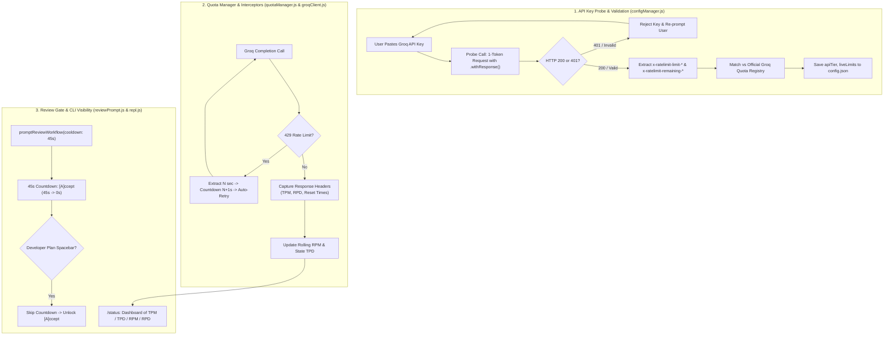

# Implementation Plan: Groq API Key Validation, Official Model Quotas (TPM/TPD/RPM/RPD), 45s Cooldown, and 429 Retry Interceptor

## 1. Goal Description

Implement a comprehensive, production-grade rate limit and quota governance system for Quillbot grounded in **official Groq documentation** and **real-time API response headers**:
1. **Live API Key Validation & Official Quota Callout:** Whenever the user inputs or pastes their Groq API key (during onboarding or `/config`), execute an immediate lightweight 1-token probe call.
   - If invalid (HTTP 401), reject the key and re-prompt in a loop until a valid key is provided.
   - If valid, extract real live limits from Groq's HTTP response headers (`x-ratelimit-limit-tokens`, `x-ratelimit-remaining-tokens`, `x-ratelimit-limit-requests`, `x-ratelimit-remaining-requests`, `x-ratelimit-reset-*`).
   - Match live limits against the **Groq Official Model Quota Registry** to determine the user's tier (`Free Plan` vs `Developer / Pay-As-You-Go Plan`) dynamically without arbitrary magic numbers.
2. **Per-Model Rolling Quota Tracking:** Groq tracks separate quotas per model. Track real-time consumption and remaining limits across all four Groq metrics:
   - **TPM (Tokens Per Minute):** Live from `x-ratelimit-limit-tokens` & `x-ratelimit-remaining-tokens`.
   - **RPD (Requests Per Day):** Live from `x-ratelimit-limit-requests` & `x-ratelimit-remaining-requests`.
   - **RPM (Requests Per Minute):** Tracked via rolling 60-second request timestamp window against the model's official limit (30 RPM Free vs 1,000 RPM Developer).
   - **TPD (Tokens Per Day):** Tracked via cumulative daily token consumption recorded in `.quillbot/state.json` against the model's official limit (200,000 TPD Free vs Pay-As-You-Go).
3. **45-Second Cooldown & Review Buffer:** Whenever content is generated (chapter plan, single beat plan, beat prose, full manuscript edit, or bible additions), enforce a 45-second reading countdown next to `[A]ccept`.
   - **Free Plan:** `[A]ccept` is held and locked until the countdown reaches 0 (`45s -> 0s`). Other options (`[E]dit`, `[R]etry`, `[P]ause`, `[F]ix`) remain immediately accessible.
   - **Developer Plan (Paid):** Users can tap the **Spacebar** at any time to skip the countdown instantly.
4. **429 Retry Interceptor with Live Countdown:** When Groq returns a `429 Too Many Requests` error, catch the error, extract wait duration $N$ from headers (`retry-after`) or the error string (`"Please try again in N.Ns"`), display a live countdown spinner (`Rate limit reached. Retrying in N+1s...`), and automatically retry at $N+1$ seconds up to 3 times before failing.
5. **CLI Quota Visibility:** Display remaining daily tokens, per-minute tokens, per-minute requests, and per-day requests per model in `/status` and during generation/review.

---

## 2. Official Groq Quota Registry (From Groq Documentation)

Instead of using arbitrary magic thresholds, Quillbot introduces an official registry reflecting Groq's published model rate limits:

### Official Model Baseline Quotas Table

| Model ID | Plan Tier | RPM | TPM | RPD | TPD |
| :--- | :--- | :---: | :---: | :---: | :---: |
| **`openai/gpt-oss-120b`** | **Free Plan** | **30** | **8,000** | **1,000** | **200,000** |
| | **Developer Plan** | **1,000** | **250,000** | High / Uncapped | Pay-as-you-go |
| **`openai/gpt-oss-20b`** | **Free Plan** | **30** | **8,000** | **1,000** | **200,000** |
| | **Developer Plan** | **1,000** | **250,000** | High / Uncapped | Pay-as-you-go |
| **`llama-3.1-8b-instant`** | **Free Plan** | **30** | **6,000** | **14,400** | **500,000** |
| | **Developer Plan** | **1,000** | **250,000** | High / Uncapped | Pay-as-you-go |
| **`llama-3.3-70b-versatile`** | **Free Plan** | **30** | **12,000** | **1,000** | **100,000** |
| | **Developer Plan** | **1,000** | **250,000** | High / Uncapped | Pay-as-you-go |

### How Tier Detection Works via API Probe Call
When the user enters their API key:
1. Quillbot makes a 1-token call to `/openai/v1/chat/completions` using the configured model.
2. The response header `x-ratelimit-limit-tokens` is read directly from Groq:
   - If `liveLimitTokens <= GROQ_QUOTAS[model].free.tpm` (e.g. `8000`): Identified as **Free Plan**.
   - If `liveLimitTokens >= GROQ_QUOTAS[model].developer.tpm` (e.g. `250000`): Identified as **Developer Plan (Pay-as-you-go)**.
   - If Groq provisioned custom limits, the exact live values from the headers are preserved and displayed.
3. No arbitrary guessing: the limits come directly from Groq's live gateway and match official documentation.

---

## 3. Architecture & Data Flow



---

## 4. Proposed Changes

### Component A: Quota & Rate Limit Engine

#### [NEW] `src/llm/quotaManager.js`
A dedicated module containing:
1. `GROQ_OFFICIAL_QUOTAS`: Object storing official limits (RPM, RPD, TPM, TPD) for all Groq models on Free and Developer plans.
2. `probeApiKey({ apiKey, model })`: Executes a 1-token probe request with `.withResponse()`.
   - Returns `{ valid: true, tier, limits: { tpm, rpd, rpm, tpd }, remaining: { tpm, rpd } }` or `{ valid: false, error }`.
3. `recordHeaders(model, headers, usage)`:
   - Updates live TPM and RPD from `x-ratelimit-limit-*` and `x-ratelimit-remaining-*`.
   - Tracks 60-second sliding array of request timestamps for real-time RPM.
   - Accumulates daily token usage for TPD in `.quillbot/state.json`.
4. `isPaidTier()`: Returns true if detected as Developer Plan or config override.
5. `getDashboardData()`: Returns formatted numbers for CLI rendering.

---

### Component B: Groq Client Interceptors

#### [MODIFY] `src/llm/groqClient.js`
- **Response Header Capture:** Update `chatCompletion`, `jsonCompletion`, and `streamChatCompletion` using `.withResponse()`. Pipe headers and token usage into `quotaManager.recordHeaders(resolvedModel, response.headers, usage)`.
- **429 Retry Interceptor with Live Countdown:** Wrap calls in `_executeWithRetry(fn, { model, workflow, maxRetries = 3 })`:
  ```javascript
  // When err.status === 429:
  const retryHeader = err.headers?.get('retry-after') || err.response?.headers?.get('retry-after');
  const msgMatch = (err.message || '').match(/try again in ([\d\.]+)s/i);
  const waitSeconds = Math.ceil(parseFloat(retryHeader || msgMatch?.[1] || '8'));
  const targetWait = waitSeconds + 1;
  
  // Display live countdown spinner:
  // "Rate limit reached (429) on [model]. Groq requested wait: Ns. Retrying in N+1s..."
  // Tick countdown every 1s, then retry request.
  ```

---

### Component C: Configuration & Onboarding Validation

#### [MODIFY] `src/config/configManager.js`
- In `runOnboardingWizard(cwd)`:
  - Wrap API key input in a `while (!valid)` loop.
  - Call `QuotaManager.probeApiKey({ apiKey: candidateKey, model: smallModel })`.
  - If invalid: show `Groq API Key rejected (HTTP 401). Please paste again.` and re-prompt.
  - If valid: print the official Quota Profile Callout (Plan Tier, TPM, RPD, RPM, TPD).
  - Save `apiTier: 'free' | 'paid'`, `rateLimits`, and `cooldownSeconds: 45` into `config.json`.
- In `loadConfig(cwd)`:
  - Defaults include `apiTier: 'free'`, `cooldownSeconds: 45`, `rateLimits: {}`.

#### [MODIFY] `src/config/stateManager.js`
- Add daily token & request tracking helper:
  - `recordDailyTokens(model, tokens, cwd)`
  - `getDailyTokens(model, cwd)`
  - Stores under `state.dailyUsage: { [dateStr]: { [model]: { tokens, requests } } }`. Automatically resets when the date changes.

---

### Component D: 45-Second Cooldown & Review Gate

#### [MODIFY] `src/ui/reviewPrompt.js`
- In `hotkeySelect`:
  - Accept `cooldownSeconds: 45`, `isPaid: boolean`.
  - Use `@inquirer/core` hooks (`useState`, `useRef`, `useEffect`) to run a deterministic 1-second countdown interval.
  - Choice display:
    - If `countdown > 0`:
      - Free Plan: `[A]ccept - Commit and proceed (${countdown}s cooldown)`
      - Developer Plan: `[A]ccept - Commit and proceed (${countdown}s - Press [Space] to skip)`
    - If `countdown === 0`:
      - `[A]ccept - Commit and proceed`
  - Keypress interception:
    - If `isPaid && isSpaceKey(key) && countdown > 0`: immediately set `countdown = 0` and unlock `[A]ccept`.
    - If user presses `a` or `Enter` on `[A]ccept` while `countdown > 0`: block action and print notice:
      `⏳ 45s Cooldown Active: ${countdown}s remaining before you can accept. (Review prose cadence).`
    - Hotkeys `r` (`[R]etry`), `e` (`[E]dit`), `p` (`[P]ause`), `f` (`[F]ix`) remain **immediately responsive** and are never blocked by the cooldown.
- In `promptReviewWorkflow`:
  - Pull `isPaid` and `cooldownSeconds` (default 45) from `config` / `quotaManager`.

---

### Component E: Workflows & CLI Quota Visibility

#### [MODIFY] `src/ui/repl.js` & `src/ui/renderer.js`
- In `/status`:
  - Render a dedicated **Quotas & Rate Limits Dashboard** displaying:
    - Model ID (Small & Large).
    - **TPM (Tokens / Min):** `[Used / Limit]` | `Remaining: X` (resets in Ys).
    - **TPD (Tokens / Day):** `[Used / Limit]` | `Remaining: X`.
    - **RPM (Requests / Min):** `[Used / Limit]` | `Remaining: X`.
    - **RPD (Requests / Day):** `[Used / Limit]` | `Remaining: X`.
- In workflows (`writeChapter.js`, `planChapter.js`, `initProject.js`, `chatBible.js`):
  - Pass `quotaManager` and active model to `promptReviewWorkflow` so review gates display the countdown and quota status.

---

## 5. Verification Plan

### Automated Unit & Feature Tests
Create a dedicated test file: [`test/v4quota.test.js`](file:///f:/quillbot/test/v4quota.test.js):
1. **API Key Probe & Validation Test:**
   - Mock Groq API response with valid headers -> returns `{ valid: true, tier: 'free', limitTpm: 8000, limitRpd: 1000 }`.
   - Mock Groq API response with 401 error -> returns `{ valid: false, error: 'Invalid API Key' }`.
2. **Quota Tracking Test:**
   - Verify `quotaManager.recordHeaders` correctly parses `x-ratelimit-*` headers per model.
   - Verify rolling RPM window updates and expires after 60s.
   - Verify daily state tracking resets on date change.
3. **429 Retry Interceptor Test:**
   - Mock a call throwing 429 with `"try again in 2s"` message -> verify interceptor waits 3s and retries successfully.
4. **45s Cooldown & Hotkey Select Test:**
   - Simulate `hotkeySelect` with `cooldownSeconds: 2`:
     - Pressing `a` at 2s is blocked.
     - Countdown ticks down to 0s -> pressing `a` resolves with `'accept'`.
     - Pressing `e` at 2s resolves immediately with `'edit'`.
   - Simulate paid user: pressing `Spacebar` at 2s immediately unlocks accept.
5. **Full Test Suite:**
   - Run `npm test` to ensure all 45 existing tests continue to pass alongside the new quota tests.

### Manual Verification
1. Run `node ./bin/quillbot.js` in a test workspace:
   - Run `/config`, enter an invalid key (`gsk_invalid123`), verify wizard rejects it and re-prompts.
   - Enter a valid key, verify the plan and official quota callout appears (8k TPM / 1k RPD / 30 RPM / 200k TPD).
2. Run `/status`, verify the quota table displays TPM, TPD, RPM, RPD remaining per model.
3. Run `/plan 1` or `/write 1`, verify the 45s countdown appears next to `[A]ccept`:
   - Verify `[A]ccept` cannot be triggered until 0s on free tier.
   - Verify `[E]dit` and `[P]ause` can be pressed immediately.
   - If on paid tier, verify pressing `Spacebar` skips the countdown immediately.
