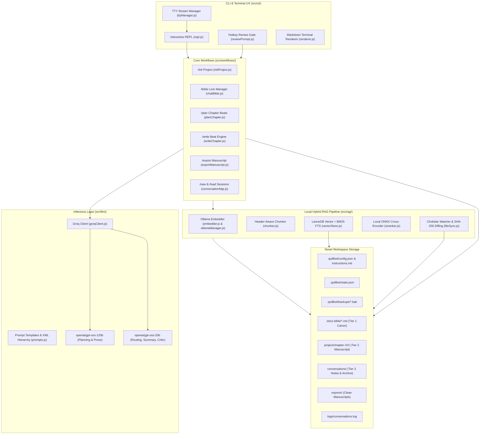
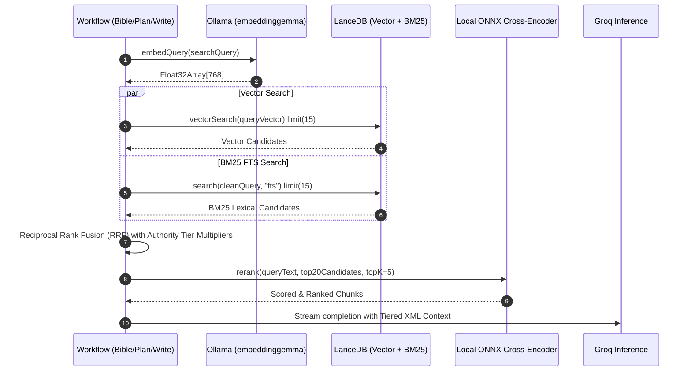

# Quillbot — Technical Project Documentation (`project.md`)

## 1. Executive Summary

**Quillbot** is a turn-based, interactive CLI story-writing agent designed for fiction authors and novelists. It transforms a standard terminal into an intelligent creative studio by pairing cloud inference via **Groq** with an entirely local, offline-capable **Hybrid RAG** (Retrieval-Augmented Generation) pipeline.

Unlike generic AI writing tools that produce disjointed prose or suffer from context drift, Quillbot treats novel writing as a disciplined, iterative, and architecture-guided craft. It enforces a strict **Hierarchy of Truth** anchored in the **Story Bible**, plans narratives into deterministic **Beats**, writes scenes incrementally with human-in-the-loop review, and audits every beat with an automated **Continuity Critic**.

### Core Value Propositions
- **Story Bible as Absolute Truth (Tier 1):** Easily editable markdown/text files (`story-bible/**/*.md` and `.txt`, supporting nested folders) dictate canon, character traits, lore, and world rules.
- **Local Hybrid Retrieval (Vector + BM25 + Cross-Encoder Reranking):** Semantic search (via Ollama `embeddinggemma`) and lexical keyword search (via LanceDB BM25 FTS) are merged using Reciprocal Rank Fusion (RRF) and scored locally on CPU by a 23MB ONNX Cross-Encoder model.
- **Beat-by-Beat Prose Engine:** Writes prose one beat at a time with instant review gates (`[A]ccept`, `[R]etry`, `[E]dit`, `[F]ix`, `[P]ause`), preventing narrative rush and hallucination.
- **Non-Destructive Editing & Safety Backups:** Automatically creates timestamped backups in `.quillbot/backups/` before modifying existing chapters or bible files.
- **Rock-Solid TTY Stream Management:** Features a dedicated Windows console lifecycle manager (`ttyManager.js`) preventing stdin freezing and enabling single-keystroke hotkeys.
- **Clean Manuscript Compilation:** Compiles chapters into publication-ready Markdown or Plain Text with scene breaks and word count analytics via `/export`.

---

## 2. System Architecture

The following diagram illustrates the end-to-end data flow and interaction between the CLI REPL, the local RAG engine, the Groq cloud inference models, and the novel workspace files.



---

## 3. Directory & Codebase Anatomy

### 3.1 Repository Layout

```text
quillbot/
├── bin/
│   └── quillbot.js             # Executable CLI entrypoint (#!/usr/bin/env node)
├── src/
│   ├── index.js                # Bootstrap orchestrator, health checks, & startup sequence
│   ├── config/
│   │   ├── backupManager.js    # Pre-write safety backups in .quillbot/backups/
│   │   ├── condensedManager.js # Token-efficient .condensed/ scene plans & story-so-far memory
│   │   ├── configManager.js    # .quillbot/config.json, instructions.md, & setup wizard
│   │   ├── logger.js           # Comprehensive LLM request/response payload logger
│   │   └── stateManager.js     # .quillbot/state.json tracker (hashes, active chapter/beat)
│   ├── llm/
│   │   ├── groqClient.js       # Streaming, standard, and JSON completions with Groq SDK & retry
│   │   ├── prompts.js          # XML Hierarchy of Truth prompts, beat schemas, and critic
│   │   └── quotaManager.js     # Groq rate-limit probing & local token budget tracker
│   ├── rag/
│   │   ├── chunker.js          # Header-aware markdown splitting with context metadata prefixing
│   │   ├── embedder.js         # Local Ollama /api/embed client (embeddinggemma)
│   │   ├── fileSync.js         # Incremental SHA-256 diffing & chokidar background watcher
│   │   ├── ollamaManager.js    # Process supervisor: probe, auto-start, & auto-pull Ollama
│   │   ├── reranker.js         # Local ONNX cross-encoder (Xenova/ms-marco-MiniLM-L-6-v2)
│   │   └── vectorStore.js      # LanceDB schema, BM25 FTS index, vector search, & RRF fusion
│   ├── ui/
│   │   ├── renderer.js         # Terminal markdown formatting, spinners, banners, & help
│   │   ├── repl.js             # Turn-based chat loop with instant slash menu interception
│   │   ├── reviewPrompt.js     # Single-character hotkey review gate [A/R/E/F/P] & $EDITOR spawn
│   │   └── ttyManager.js       # Windows TTY stream lifecycle and stdin protection
│   └── workflows/
│       ├── chatBible.js        # /bible: query, create, edit, list, and extract lore
│       ├── conversationMgr.js  # Rolling sliding-window chat memory and session archiving
│       ├── exportManuscript.js # /export: compiles clean manuscripts (.md / .txt) with word counts
│       ├── initProject.js      # /init: seeds 4 Story Bible files from story synopsis
│       ├── planChapter.js      # /plan: chapter beat architecture and single-beat updates
│       └── writeChapter.js     # /write: beat-by-beat generation, continuity window, & critic
├── test/
│   ├── config.test.js          # Config, state, and logging unit tests
│   ├── features.test.js        # Core features: conversation archiving, backups, hotkeys
│   ├── rag.test.js             # Chunker, vector store, reranker, and file sync tests
│   ├── v2features.test.js      # Targeted single-beat writes, continuity critic, & export
│   ├── v3features.test.js      # Ollama manager, out-of-order writes, beat edits, & REPL guards
│   ├── v4quota.test.js         # Quota manager tracking, free/paid tier gating, & retry tests
│   ├── v6condensedFlow.test.js # Condensed continuity horizon & story-so-far flow tests
│   ├── v7auditFixes.test.js    # Architectural audit fixes & KV-prefix ordering tests
│   ├── v8queryRouting.test.js  # Query routing, readable streaming, & scoped RAG tests
│   ├── v9integration.test.js   # Non-mocked HTTP, Ollama, LanceDB, ONNX & watcher tests
│   └── workflows.test.js       # Parsing, continuity windowing, and slash completion
├── package.json                # Project dependencies, scripts, and engine constraints
└── plan.md                     # Original product architecture specification
```

---

## 4. User Novel Workspace Structure

When Quillbot initializes in any novel directory, it creates and maintains this standardized layout:

```text
<user-novel-workspace>/
├── .quillbot/
│   ├── config.json             # Groq keys, model IDs, RAG hyperparameters, editor
│   ├── instructions.md         # Global literary prose guidelines, POV, tense, tone
│   ├── state.json              # File SHA-256 hashes, active chapter, active beat index
│   ├── backups/                # Timestamped safety backups of modified files
│   └── index/                  # Local LanceDB vector & BM25 tables (quillbot_chunks.lance)
├── story-bible/                # Directory (.md and .txt, flat or nested subfolders) [Tier 1 Canon]
│   ├── characters.md           # Character sheets, relationships, appearances, motivations
│   ├── world-and-lore.md       # Magic/technology systems, historical timeline, rules
│   ├── locations.md            # Sensory descriptions, geography, key landmarks
│   └── plot-overview.md        # Major narrative arcs, act structures, thematic stakes
├── .condensed/                 # Compact rolling continuity summaries [Tier 2 Progress]
│   ├── story-so-far.md         # Multi-chapter canonical bullet progression
│   └── chapters/
│       └── chapter-XX/
│           ├── plan.md         # Condensed beat plans
│           └── prose.md        # Condensed beat prose outcomes
├── project/                    # Chapter manuscripts and beat outlines [Tier 2 Canon]
│   ├── chapter-01/
│   │   ├── plan.md             # Summary and structured beats (Beat 1, Beat 2, ...)
│   │   ├── chapter.md          # Concatenated beat prose with <!-- BEAT N --> markers
│   │   └── summary.md          # 250-word canonical chapter recap generated upon completion
│   └── chapter-02/
│       └── ...
├── conversations/              # Dialogue history and brainstorming memory [Tier 3 Canon]
│   ├── current.json            # Active session turns and rolling summary
│   └── archive/                # Past sessions (session-<timestamp>.json and .md summaries)
├── exports/                    # Clean compiled manuscripts generated via /export
│   ├── <title>-manuscript.md   # Clean full-novel manuscript without beat markers
│   └── <title>-chapter-01.txt  # Clean plain-text single-chapter export
└── logs/
    └── conversations.log       # Audit log of outgoing LLM prompts, tokens, and responses
```

---

## 5. Deep-Dive: Core Subsystems

### 5.1 The Local Hybrid RAG Pipeline

Quillbot uses a 3-stage local retrieval process that executes entirely on the author's local machine without third-party vector databases or external embedding API fees:



#### 1. Header-Aware Chunking & Context Header Prepending (`chunker.js`)
- Indexes `.md` and `.txt` files across `story-bible/` (including nested subfolders), `project/`, `.condensed/`, and `conversations/archive/`.
- Splits markdown files by headings (`#`, `##`, `###`), merging heading-only blocks forward into their subsequent content section and preserving cohesive blocks under 400 tokens (~1,600 characters). Larger sections are subdivided by double newline with a 60-token overlap.
- Prepends each chunk with its source metadata for lexical matching while `embedTexts` embeds semantic section title + body without noisy bracket tags:
  ```text
  [File: story-bible/characters.md | Section: Jonathan Blackwood | Type: story-bible | Tier: 1]
  <chunk_body>
  ```
  This ensures BM25 full-text queries match character and location names even when the term only appears in the section header.

#### 2. Dual Search & Reciprocal Rank Fusion (RRF) (`vectorStore.js`)
Parallel queries run against LanceDB:
1. **Vector Search:** Euclidean / Cosine similarity against 768-dimensional Ollama embeddings.
2. **BM25 Keyword Search:** Native full-text index on the `text` column with position tracking.

The hits are merged using Reciprocal Rank Fusion with authority tier multipliers ($k = 60$):

$$\text{RRF\_Score}(d) = w_{\text{tier}} \times \left( \frac{1}{k + \text{rank}_{\text{vector}}(d)} + \frac{1}{k + \text{rank}_{\text{bm25}}(d)} \right)$$

- **Tier 1 (Story Bible):** $w_{\text{tier}} = 1.08$ (Highest priority canon)
- **Tier 2 (Manuscript Chapters & `.condensed` Progress):** $w_{\text{tier}} = 1.05$ (Established manuscript)
- **Tier 3 (Archived Conversations):** $w_{\text{tier}} = 0.95$ (Brainstorming notes)

#### 3. Local ONNX Cross-Encoder Reranker (`reranker.js`)
- Uses `@huggingface/transformers` to lazy-load `Xenova/ms-marco-MiniLM-L-6-v2`.
- Evaluates the top 20 fused candidates (stripping the leading `[File: ...]` tag before scoring) by tokenizing `(query, document_text)` pairs directly on the CPU without requiring Python.
- Applies a sigmoid function to raw logits and adds a soft additive tie-breaker (`+0.02` for Tier 1 canon, `+0.01` for Tier 2 manuscript), with optional `minScore` filtering, to return the top ranked chunks.

#### 4. Automated Ollama Supervisor (`ollamaManager.js` & `embedder.js`)
- Detects whether the configured base URL is local (`127.0.0.1`, `localhost`).
- If Ollama is offline, it spawns `ollama serve` detached in the background, waits for the socket to open, and auto-pulls `embeddinggemma` if the model is missing.

---

### 5.2 The Hierarchy of Truth & Prompt Engineering

Quillbot enforces a strict truth and instruction hierarchy in all prompt templates using explicit XML delimiters (`src/llm/prompts.js`):

```xml
<system_instructions>
# Author Writing Style Preferences & Core Directives
</system_instructions>

<hierarchy_of_truth_rules>
Source Truth Precedence:
1. Past Chapters & Progress (Highest Precedence — established manuscript events, chapter summaries, and condensed progress override earlier global lore)
2. Story Bible Canon (Global Baseline Lore — foundational world rules, character dossiers, and overarching timeline)
3. Past Conversations (Brainstorming Notes — exploratory ideation, lowest precedence)

Instruction Precedence:
Beat-Specific Instructions > Chapter-Level Instructions > Global Writing Style.
</hierarchy_of_truth_rules>

<past_chapters>
### Chapter 1 Summary:
Jonathan arrived at Oakhaven and met Rowan at dusk.
</past_chapters>

<story_bible_canon>
[Source: story-bible/characters.md - Section: Jonathan]
Jonathan is 32 years old, left-handed, with a scarred eyebrow.
</story_bible_canon>

<past_conversations>
### Rolling Discussion Summary:
Considered making Jonathan a spy, but decided he is an exiled cartographer.
</past_conversations>
```

#### Groq Prefix Caching Optimization
Prompts sent to `openai/gpt-oss-120b` place invariant context (system instructions, global style, and full chapter `plan.md`) at the top of the prompt. Dynamic elements (retrieved chunks, preceding prose tail, and target beat directives) are appended at the bottom, maximizing Groq's KV-cache hit rate.

---

### 5.3 Beat-by-Beat Prose Engine & Continuity Critic

The writing workflow (`src/workflows/writeChapter.js`) breaks chapter writing into micro-units called **Beats**.

#### 1. Plan Schema (Technical Blueprints)
Plans (`project/chapter-XX/plan.md`) use clean Markdown (no tables) parsable by regex `/^### Beat (\d+): (.*?)$/gm`. Plans read like technical architectural blueprints rather than pieces of literature, specifying step-by-step action sequences and concrete state changes:
```markdown
# Chapter 1: The Gathering Mist

## Chapter Summary
Jonathan reaches Blackwood Ridge and rendezvous with Rowan under cover of darkness to secure the crypt key.

## Chapter Instructions
Atmospheric, steady pacing; heighten cold wind and rusted iron textures; keep dialogue sparse and guarded.

## Beats

### Beat 1: The Ascent
- **Characters:** Jonathan Blackwood
- **Location:** Blackwood Ridge Crest
- **Action:** 1. Jonathan navigates the frozen rocky incline as dusk turns to night. 2. He spots a patrol torchline across the gorge and takes cover behind the jagged granite outcrop. 3. He counts three sentries before advancing.
- **Goal/Hook:** Reach the vantage point undetected; he spots Rowan's lantern signal flashing from the crypt entrance below.
- **Instructions:** Emphasize the bitter frost against his knuckles and the crunch of shale underfoot.

### Beat 2: The Meeting
- **Characters:** Jonathan Blackwood, Rowan Cole
...
```

#### 2. Continuity Window & Scene Anchoring
When writing Beat $N$:
- **Preceding Tail:** Retrieves the verbatim last 350 words of prose from Beat $N-1$ (sliced strictly before Beat $N$), providing immediate rhythm, spatial position, and sensory continuity.
- **Downstream Anchor:** If editing an earlier beat (e.g., rewriting Beat 2 when Beat 3 is already written), Quillbot extracts the first 150 words of Beat 3 and instructs the model to end Beat 2 seamlessly at that scene threshold.
- **Out-of-Order Safety:** When beats are committed, `commitBeatToChapter` parses all existing `<!-- BEAT N -->` blocks and writes them back in strictly sorted numerical order (Beat 1 always precedes Beat 2).

#### 3. Pre-Review Continuity Critic Audit
Before presenting drafted prose to the author, Quillbot runs an automated audit pass using `openai/gpt-oss-20b` (`CONTINUITY_CRITIC_SYSTEM_PROMPT`):
- Audits drafted prose against Tier 1 canon (names, physical traits, moral alignment, dead/alive status).
- Audits narrative progression and anti-stalling (`scene_stalling`): ensures the beat does not stall the story by repeating identical morning/scenic routines already performed in prior beats.
- Verifies beat boundaries (ensuring the model did not rush ahead into future beats).
- Validates immediate scene physics (lighting, weather, held items, injuries).
- If issues are flagged, the CLI displays the quote, contradiction, and suggested fix, and adds a dedicated **`[F]ix`** hotkey to the review menu. Pressing `F` automatically feeds the critic's instructions back into the regenerator.

#### 4. 4-Tier AI Creativity & Expressiveness Engine (`off`, `low`, `medium`, `high`)
Configurable in `.quillbot/config.json` (`generation.creativity`) and selected during the setup wizard.
- **Strict Zero-Invention Rule (All Levels):** At ALL levels (`off`, `low`, `medium`, `high`), creating new details, unmentioned characters, plot events, unrequested twists, physical contradictions, or unmentioned props is STRICTLY FORBIDDEN. Creativity tiers govern ONLY the stylistic expressiveness and prose rendering of author-dictated material.
- **`off` (Strict Fidelity & Literal Execution):** Zero extrapolation. Direct literal translation adhering entirely to what was told by the author without creating even a single detail. Temperatures: Plan 0.1, Write 0.3, Summaries 0.1. Reasoning: `low`. Max Tokens: 2,048.
- **`low` (Guided Fidelity & Clean Prose):** Zero invented details. Clean, unadorned prose with minimal physical connective tissue. Temperatures: Plan 0.3, Write 0.5, Summaries 0.15. Reasoning: `low`. Max Tokens: 3,072.
- **`medium` (Balanced Collaboration - Paid Tier Exclusive):** Zero invented details. Richer sensory cadence, textured atmosphere, and emotional subtext strictly grounded in the author's specified scene. Temperatures: Plan 0.6, Write 0.75, Summaries 0.2. Reasoning: `medium`. Max Tokens: 4,096.
- **`high` (Lyrical & Expansive - Paid Tier Exclusive):** Zero invented details. Vivid, lyrical prose rendering with maximum character interiority and atmospheric depth without manufacturing any plot points. Temperatures: Plan 0.85, Write 0.95, Summaries 0.3. Reasoning: `high`. Max Tokens: 6,144.
- **Paid Plan Gating:** `medium` and `high` creativity and reasoning are locked to paid plan users (`apiTier === 'paid' || apiTier === 'developer'`). Free tier users are restricted in the setup wizard and auto-clamped to `low` in `loadConfig`.

---

### 5.4 Windows TTY Stream Management & Hotkey UI

Interactive CLI tools on Windows frequently suffer from stdin freezes when chaining `@inquirer` prompts. 

#### Root Cause Solved in `src/ui/ttyManager.js`
When an Inquirer prompt settles upon receiving Enter, its internal cleanup invokes `readline.close()`, which calls `process.stdin.pause()` and `process.stdin.setRawMode(false)`. On Windows, this drops the console driver back into line-buffered mode (`ENABLE_LINE_INPUT`). Subsequent prompts calling `setRawMode(true)` find libuv's console reader blocked waiting for an OS-level carriage return.

#### The Solution:
- `enableStdinProtection()` intercepts `process.stdin.pause()` and `process.stdin.setRawMode(false)` during the session, preventing readline teardowns from unhooking the event loop.
- `suspendStdinProtection()` cleanly drops raw mode when spawning external text editors (Notepad, Nano, VS Code) and restores protection upon child process exit.
- `hotkeySelect` (`src/ui/reviewPrompt.js`) enables instant, single-keypress actions:
  - `A`: Accept and commit
  - `R`: Retry with revision feedback
  - `E`: Spawn `$EDITOR` with a temporary file
  - `F`: Auto-fix Continuity Critic findings
  - `P`: Pause writing session and return to prompt
  - `D`: Discard changes

---

## 6. Complete Slash Command Reference

Quillbot features an interactive dropdown menu. Typing `/` anywhere in the REPL instantly opens the command selector:

| Command | Syntax / Options | Description |
| :--- | :--- | :--- |
| **/write** | `/write [chapter] [beat] [notes]` | Generates or edits prose beat-by-beat. If a chapter is complete, opens Chapter Edit Mode (single beat, all beats, full editorial pass, or summary regeneration). |
| **/plan** | `/plan [chapter] [beat\|add] [guidance]` | Plans chapter beats in structured paragraphs. Supports editing existing plans, editing single beats, or adding new beats (`/plan 1 add`). |
| **/bible** | `/bible [query\|save\|create\|edit\|list]` | Lore management. Without arguments, displays an interactive menu: Query Lore, Create File, Edit File (with backup), List Files (with word counts), or Save Lore from chat. |
| **/export** | `/export [chapter\|range\|all] [txt\|scene-breaks]` | Compiles clean manuscripts to `exports/`. Strips `<!-- BEAT N -->` markers and placeholder headers. Supports ranges (`1-3`), Markdown (`.md`), Plain Text (`.txt`), and `* * *` scene breaks. |
| **/chat** | `/chat [message]` | Conversational consultation with Story Bible and project context via Hybrid RAG. (Typing any non-slash text in the REPL routes here by default). |
| **/status** | `/status` | Displays project title, active writing style, active chapter, current beat, tracked files, LanceDB chunk counts, and model configurations. |
| **/sync** | `/sync` | Triggers a manual incremental sync: compares SHA-256 hashes against `state.json`, deletes removed files from LanceDB, re-chunks modified files, and rebuilds BM25 index. |
| **/config** | `/config` | Launches the interactive configuration wizard to adjust Groq API keys, model selections, Ollama URLs, writing style preferences, or text editor. |
| **/init** | `/init` | Seeds a new project from a story synopsis. Generates `characters.md`, `world-and-lore.md`, `locations.md`, and `plot-overview.md` in paragraph format. |
| **/new** | `/new` | Auto-archives `conversations/current.json` to `conversations/archive/` (JSON + summary markdown for RAG indexing) and starts a clean session. |
| **/load** | `/load` | Lists archived conversation sessions with interactive selector and restores the chosen session into `current.json`. |
| **/archive** | `/archive` | Explicitly archives the current session and resets `current.json`. |
| **/help** | `/help` | Displays the formatted CLI command reference and keyboard guide. |
| **/exit** | `/exit` or `exit` / `quit` | Closes file watchers, shuts down LanceDB connections, and cleanly terminates the CLI. |

---

## 7. Configuration & File Schemas

### 7.1 `.quillbot/config.json`
```json
{
  "projectTitle": "Chronicles of Oakhaven",
  "writingStyle": "Third-person limited, atmospheric, sensory-rich prose with psychological depth",
  "enhancedWritingStyle": "## 1. Point of View...\n## 2. Prose Rhythm...",
  "groqApiKey": "gsk_...",
  "models": {
    "small": "openai/gpt-oss-20b",
    "large": "openai/gpt-oss-120b"
  },
  "ollama": {
    "baseUrl": "http://127.0.0.1:11434",
    "embeddingModel": "embeddinggemma",
    "embeddingDimensions": 768
  },
  "rag": {
    "chunkSizeTokens": 400,
    "chunkOverlapTokens": 60,
    "vectorTopK": 15,
    "bm25TopK": 15,
    "rerankTopK": 5,
    "rerankerModel": "Xenova/ms-marco-MiniLM-L-6-v2",
    "rrfK": 60
  },
  "generation": {
    "creativity": "medium",
    "temperaturePlan": 0.6,
    "temperatureWrite": 0.75,
    "continuityTailWords": 350,
    "slidingChatWindowTurns": 8,
    "enableContinuityCritic": true
  },
  "editor": "notepad"
}
```

### 7.2 `.quillbot/state.json`
```json
{
  "initialized": true,
  "activeChapter": 1,
  "activeBeat": 2,
  "activeConversationId": "conv_20261029_120000",
  "fileHashes": {
    "story-bible/characters.md": "a3f5b8...",
    "story-bible/world-and-lore.md": "8c1e2d...",
    "project/chapter-01/plan.md": "f94d12...",
    "project/chapter-01/chapter.md": "b48c90..."
  }
}
```

### 7.3 `project/chapter-XX/chapter.md` Manuscript Format
```markdown
# Chapter Manuscript

<!-- BEAT 1 -->
The mist clung to the pines as Jonathan reached the ridge...

<!-- BEAT 2 -->
Rowan Cole emerged from the treeline, lantern swaying in his gloved hand...
```

---

## 8. Verification & Testing

Quillbot includes an automated test suite executed via Node's native test runner (`node --test`).

```bash
npm test
```

### Test Suite Structure (89 Passing Tests)
- [`test/config.test.js`](file:///f:/quillbot/test/config.test.js):
  - State manager persistence and defaults.
  - Directory scaffolding and instructions generation.
  - Logger writes to `logs/conversations.log` for LLM inputs and responses.
- [`test/features.test.js`](file:///f:/quillbot/test/features.test.js):
  - Auto-archiving and clearing of `current.json`.
  - Non-destructive beat committing and backup generation.
  - Single-keystroke hotkey select resolution.
- [`test/rag.test.js`](file:///f:/quillbot/test/rag.test.js):
  - Chunking metadata and context header prefixing.
  - LanceDB table creation, BM25 FTS indexing, and RRF fusion.
  - ONNX cross-encoder reranking and tier score boosting.
  - Incremental SHA-256 file sync and deletion handling.
- [`test/v2features.test.js`](file:///f:/quillbot/test/v2features.test.js):
  - Strict continuity window slicing before target beat.
  - Downstream scene anchor extraction.
  - Continuity Critic JSON schema compliance and review gate `[F]ix` handling.
  - Manuscript compilation, clean prose formatting, and scene break insertion.
- [`test/v3features.test.js`](file:///f:/quillbot/test/v3features.test.js):
  - Ollama process supervisor (probe, local URL detection, auto-pull).
  - Out-of-order beat insertion ensuring ascending order in `chapter.md`.
  - In-place beat editing and completed chapter edit mode.
  - Story Bible file listing, creation, and non-destructive AI editing.
  - Single beat planning and `/plan <ch> add` workflow.
  - REPL slash-menu interception preventing speed typing freezes.
- [`test/v4quota.test.js`](file:///f:/quillbot/test/v4quota.test.js):
  - Quota manager tracking, free/paid tier gating, and 429 retry handling.
- [`test/v6condensedFlow.test.js`](file:///f:/quillbot/test/v6condensedFlow.test.js):
  - `.condensed/` layout, beat plan condensation, and story-so-far progression context.
- [`test/v7auditFixes.test.js`](file:///f:/quillbot/test/v7auditFixes.test.js):
  - Architectural audit fixes, additive rerank bonuses, and KV-prefix ordering.
- [`test/v8queryRouting.test.js`](file:///f:/quillbot/test/v8queryRouting.test.js):
  - `/bible` vs general query routing, readable streaming, and scoped RAG queries.
- [`test/v9integration.test.js`](file:///f:/quillbot/test/v9integration.test.js):
  - Non-mocked HTTP `GroqClient`, live Ollama `embeddinggemma`, LanceDB, ONNX reranker, watcher, and safety integration tests.
- [`test/v11antiHallucination.test.js`](file:///f:/quillbot/test/v11antiHallucination.test.js):
  - Permanent strict fidelity directive (`creativity: 'off'`) and invariant temperatures (0.1 plan, 0.3 write, 0.1 summary).
  - Reasoning effort configuration (`low`, `medium`, `high`), paid-tier gating, and scene baseline `medium` reasoning (4096 tokens).
  - Mandatory dialogue speaker attribution constraints in planning and writing prompts.
  - 120B high-reasoning open clarifying questions engine for `/init` and `/plan`.
  - LanceDB corruption self-healing on power failures and manifest mismatch.
- [`test/workflows.test.js`](file:///f:/quillbot/test/workflows.test.js):
  - Multi-paragraph beat parsing without tables.
  - Verbatim continuity window tail-word extraction.
  - XML Hierarchy of Truth formatting.

---

## 9. Developer & Author Getting Started Guide

### Prerequisites
1. **Node.js:** `>= 20.0.0`
2. **Ollama:** Installed and added to system `PATH` (running `ollama pull embeddinggemma` is recommended, though Quillbot can auto-pull).
3. **Groq API Key:** Free API key from [console.groq.com](https://console.groq.com).

### Quickstart
```bash
# 1. Clone repository
git clone <repo-url> quillbot
cd quillbot

# 2. Install dependencies
npm install

# 3. Link executable globally (optional)
npm link

# 4. Launch Quillbot in any novel directory
quillbot
```

### Typical Author Journey
1. **First Run Setup:** Quillbot prompts for your Groq API key, novel title, and writing style preferences.
2. **Initialize Lore (`/init`):** Paste your story synopsis. Quillbot drafts 4 foundational Story Bible files in readable paragraphs.
3. **Consult & Brainstorm (`/bible` or free chat):** Ask questions about characters or world rules. Use `/bible save` to commit new decisions to canon.
4. **Plan Chapter 1 (`/plan 1`):** Quillbot drafts 3–6 structured beats adhering to the Story Bible. Accept or revise.
5. **Write Chapter 1 (`/write 1`):** Watch the prose stream beat-by-beat. Use hotkeys:
   - Press `A` to accept and advance.
   - Press `R` to retry with revision notes.
   - Press `F` to auto-fix Continuity Critic warnings.
   - Press `E` to polish in Notepad / Nano.
6. **Export Manuscript (`/export`):** Export clean, publication-ready Markdown or text manuscripts with word count summaries.

